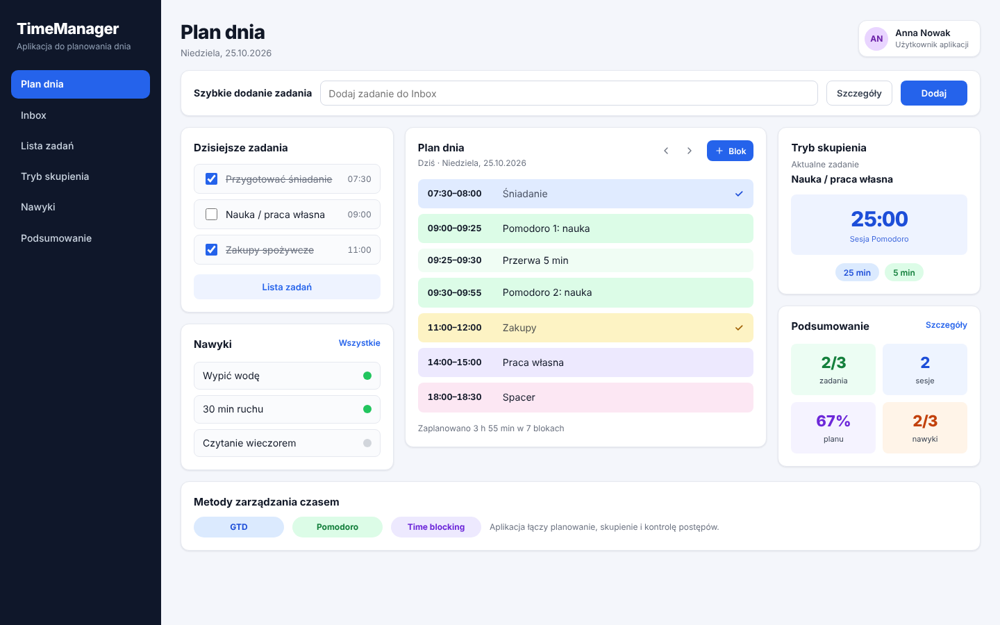
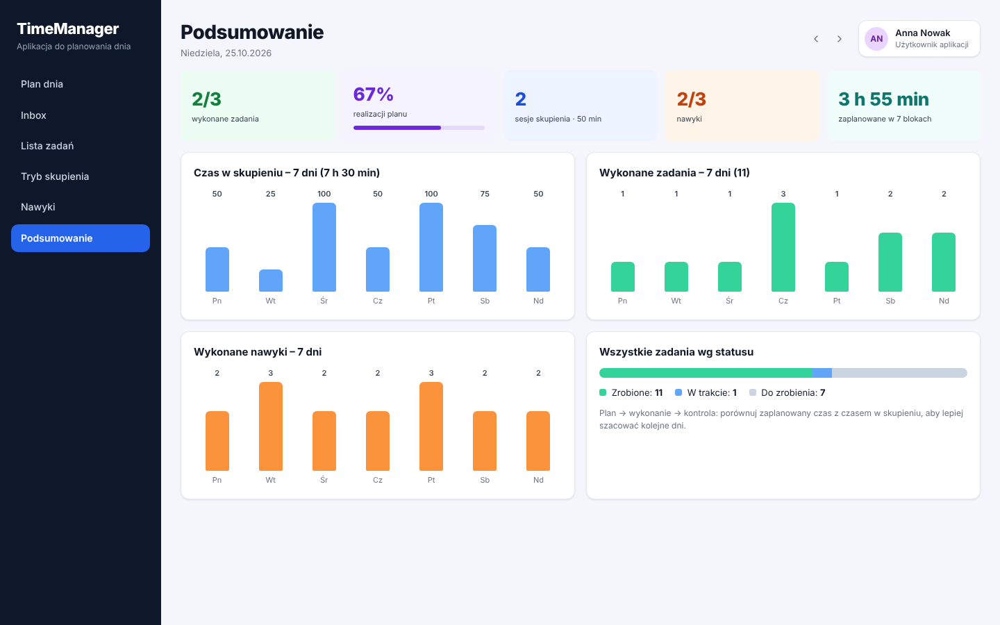
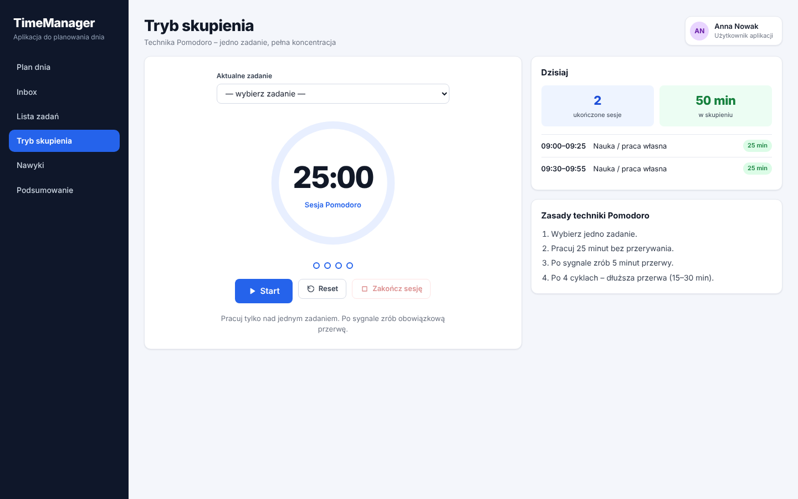
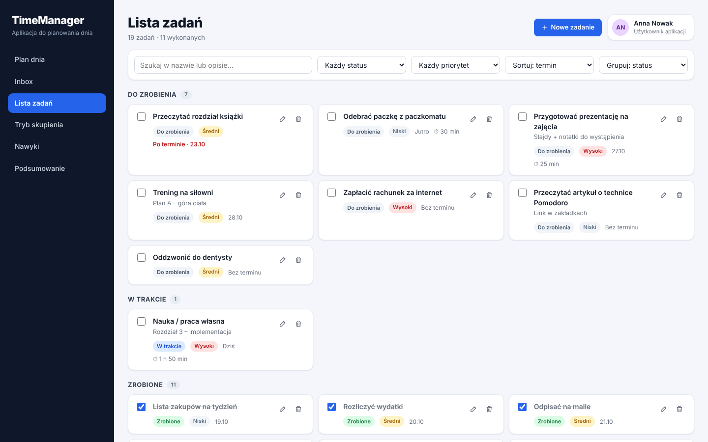
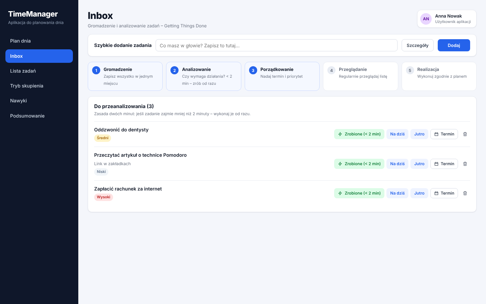
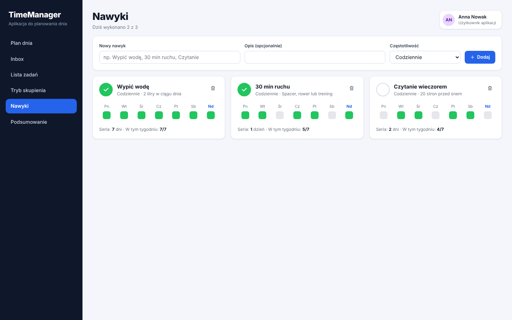

# TimeManager

Aplikacja webowa do planowania dnia i zarządzania czasem własnym. Łączy trzy sprawdzone metody w jednym miejscu: **GTD** (Inbox), **time blocking** (plan dnia) i **Pomodoro** (tryb skupienia), a do tego śledzenie nawyków i podsumowanie postępów.

> 🎓 Projekt i implementacja wykonane w ramach mojej **pracy licencjackiej**: *„Projekt i implementacja aplikacji webowej TimeManager wspierającej zarządzanie czasem własnym”* (Informatyka i Ekonometria, Uniwersytet Gdański). Powiązanie funkcji z rozdziałami pracy: [docs/praca-licencjacka.md](docs/praca-licencjacka.md).



## Funkcje

- 📥 **Inbox (GTD)** – szybkie zapisywanie zadań i ich późniejsze analizowanie (zasada 2 minut)
- 🗓️ **Plan dnia (time blocking)** – bloki czasu z przesuwaniem, zmianą długości i wykrywaniem kolizji
- 🍅 **Tryb skupienia (Pomodoro)** – timer 25/5, długa przerwa po 4 cyklach, zapis sesji do bazy
- ✅ **Lista zadań** – priorytety, statusy, terminy, wyszukiwanie, filtrowanie, sortowanie i grupowanie
- 🔁 **Nawyki** – historia 7 dni i licznik serii
- 📊 **Podsumowanie** – realizacja planu, czas w skupieniu, wykresy z ostatnich 7 dni

## Zrzuty ekranu

| Podsumowanie | Tryb skupienia |
|---|---|
|  |  |

| Lista zadań | Inbox |
|---|---|
|  |  |

| Nawyki |
|---|
|  |

*Dane na zrzutach to dane demonstracyjne z `database/seed.sql`.*

## Technologie

| Warstwa | Stack |
|---|---|
| Frontend | React 18, Vite, React Router, CSS (bez frameworka UI), Local Storage |
| Backend | Node.js, Express, REST API (JSON), walidacja danych |
| Baza danych | PostgreSQL – 6 tabel w relacjach 1:N (users, tasks, time_blocks, focus_sessions, habits, habit_logs) |

## Architektura

```
frontend (React)  ──REST/JSON──▶  backend (Express)  ──SQL──▶  PostgreSQL
  pages / components               routes → controllers → models     database/schema.sql
  services/api.js                  config/db.js, config/auth.js      database/seed.sql
```

Każde zapytanie jest filtrowane po `user_id`, więc dane są izolowane per użytkownik.

## Uruchomienie

Wymagania: **Node.js 18+**, **PostgreSQL 14+**

```bash
npm install && npm run install:all
cp backend/.env.example backend/.env   # dane dostępowe do PostgreSQL
npm run db:setup                       # tworzy bazę, tabele i dane demo
npm run dev                            # backend :4000 + frontend :5173
```

Aplikacja: **http://localhost:5173**

Produkcyjnie: `npm run build`, potem `npm start` – backend serwuje też zbudowany frontend. Na hostingu (np. Railway) wystarczy ustawić `DATABASE_URL`.

## API

| Metoda | Endpoint | Opis |
|---|---|---|
| `GET` | `/api/tasks` | Zadania (filtry: status, priorytet, szukaj, sortowanie) |
| `POST` `PUT` `DELETE` | `/api/tasks/:id` | Dodanie / edycja / usunięcie zadania |
| `GET` `POST` `PUT` `DELETE` | `/api/time-blocks` | Plan dnia (kolizja → `409`) |
| `GET` `POST` | `/api/focus-sessions` | Sesje Pomodoro |
| `GET` `POST` | `/api/habits`, `/api/habits/:id/log` | Nawyki i ich odhaczanie |
| `GET` | `/api/summary` | Podsumowanie dnia i tygodnia |

Pełna lista: [docs/praca-licencjacka.md](docs/praca-licencjacka.md#api-restjson).

## Dalszy rozwój

- Pełne logowanie i rejestracja (model danych jest już na to gotowy)
- Powiadomienia o rozpoczęciu bloku czasu
- Wersja mobilna (PWA)
